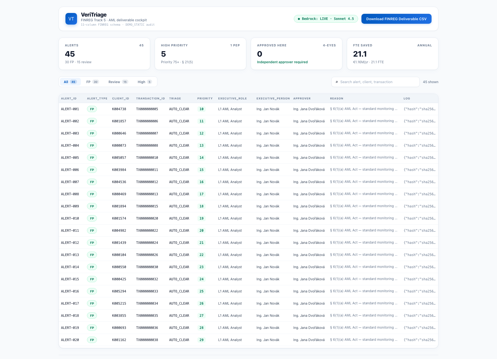

# FINAL REPORT — Advanced Cockpit + Live Bedrock

**Date:** 2026-10-19
**Status:** Frontend advanced. Bedrock is **live**. GitHub is pushed. Human rehearsal remains.

## Frontend Advancements

- **KPI strip:** 45 alerts, 30 FP, 15 review, 5 high (1 PEP), approved count, 21.1 FTE.
- **Filter and search:** All / FP / Review / High, plus search by alert, client, or transaction.
- **PEP badge** on § 21(5) rows.
- **Decision drawer:** alert type, priority, executive, 4-eyes state, statutory basis, and full reason.
- **Live/cached Bedrock card:** mode, model, latency, 4 claim cards, legal basis.
- **Audit Chain:** timeline with 5 events, green/red chain state, copy-hash, Verify Chain, and **Download audit JSON**.
- **4-eyes guardrail:** same-person state is red and blocks the signing button.
- **Light Scandinavian design system** preserved; no new packages; external Google Fonts import removed so the table renders offline.
- All 11 FINREG columns fit the 1440px shell.



## Live Bedrock

Real probe (`/api/v1/bedrock/status`):

```json
{
  "mode": "LIVE_BEDROCK",
  "model": "eu.anthropic.claude-sonnet-4-5-20250929-v1:0",
  "region": "eu-central-1",
  "latency_ms": 1207,
  "error": null
}
```

Real investigation (`/api/v1/cases/ALERT-045/investigation`):

- `mode`: `LIVE_BEDROCK`
- `latency_ms`: **12706**
- 4 claims
- legal basis: `AML Act No. 253/2008 Sb. § 21(5); Payment Services Regulation (EU) 2015/847 Article 83`

The cassette remains a labeled fallback. If the live call fails, the UI must show `LIVE_BEDROCK_CACHED`; the badge is driven by the probe, not a hardcoded string.

## Integrity Fixes Still in Place

- `/approve` rejects the same person with 400 and the exact 4-eyes body.
- `/audit` returns `mode: "DEMO_STATIC"`; the UI labels it.
- CORS allows 3000/3100 on localhost and 127.0.0.1.
- 24 backend tests; `npm run build` green.

## Verified

- `dotnet test` — **24 passed, 0 failed, 0 skipped**.
- `npm run build` — green.
- `npm test` — exit 0 (zero Node tests).
- CSV — exact 11-column header, 45 rows, 30/10/5.
- 4-eyes — same person 400; Marie 200.
- Audit — `DEMO_STATIC`, 5/5.
- CORS — `Access-Control-Allow-Origin: http://localhost:3100`.
- Normal Chrome on `http://localhost:3100` loads the table; no `--disable-web-security`.
- Backend rehearsal — 0.0356s.
- GitHub — public, `main` pushed.

## Honest Win Probability

| State | Probability |
|---|---:|
| Current: live Bedrock + advanced cockpit, no human rehearsal | **55%** |
| After 3× rehearsal of the 5-minute script | **60–65%** |
| If live latency exceeds 15s or the probe falls back | **55–60%** |

The live investigation took 12.7s. That is within the 30s final segment, but it must be pre-warmed or the presenter must be ready to use the labeled cassette.

## Human Actions

1. Pre-warm `/api/v1/cases/ALERT-045/investigation` before the timer; confirm `mode: LIVE_BEDROCK` and the 12s latency.
2. Rehearse [DEMO_SCRIPT.md](DEMO_SCRIPT.md) three times on `http://localhost:3100` in a normal browser.
3. Record `backup_video.mp4`.
4. Push the final commit.

## Links

- [AWS_BEDROCK_STATUS.md](AWS_BEDROCK_STATUS.md)
- [FIX_LOG.md](FIX_LOG.md)
- [REHEARSAL.md](REHEARSAL.md)
- [screenshots/README.md](screenshots/README.md)
