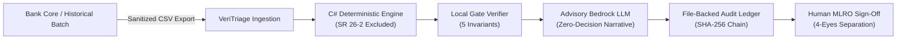
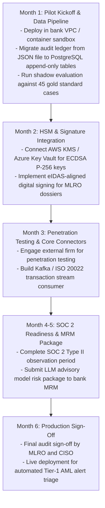

# Production Gaps & Bank-Readiness Audit Report

**VeriTriage: Honest Gap Disclosure for Institutional Pilot & POC**  
**Document Version:** 3.0 · **Date:** 20 October 2026 · **Owner:** Backend Lead  
**Status:** Pre-POC Bank Audit Disclosure  

---

## 1. Executive Disclosure: The Honest POC Position

> [!IMPORTANT]
> **The Honest POC Claim:**  
> *"We have a working, deterministic C# triage engine that SR 26-2 excludes from Model Risk Management scope. We have a hash-chained audit trail that satisfies FATF Recommendation 11. We have an explainability snapshot that satisfies Wolfsberg Group Pillar 3.  
> We do NOT have SOC 2 Type II certification, ISO 27001 certification, or Hardware Security Module (HSM) key custody. Those are institutional production gaps documented below with realistic timelines, resource requirements, and risk mitigations for our scoped pilot."*

A tier-1 or tier-2 financial institution cannot sign a production deployment contract based on a hackathon demonstration. A bank will, however, sign a **scoped Proof of Concept (POC) / Pilot Agreement** when the architecture is defensible, the deterministic core is auditable, and production gaps are transparently cataloged rather than concealed.

---

## 2. Institutional Production Gap Matrix

The following table itemizes the gaps that must be closed before graduating from a sandbox pilot to production core banking deployment:

| Gap Category | Production Requirement | Current POC State | Estimated Effort | Estimated Cost | Responsible Owner | Consequence if Unaddressed |
|---|---|---|---|---|---|---|
| **SOC 2 Type II** | Continuous security, availability, and confidentiality audit report. | Internal security controls only; no third-party audit report. | 6–9 months | \$40k–\$80k | External Auditor + DevOps Lead | Bank procurement and vendor risk management will veto production onboarding. |
| **ISO / IEC 27001:2022** | Certified Information Security Management System (ISMS). | Internal security baseline; no certified ISMS framework. | 9–12 months | \$30k–\$60k | External Auditor + CISO | Enterprise security due diligence review will fail. |
| **Third-Party Penetration Test** | Grey-box / white-box offensive security audit of API, cryptographic signing, and ledger. | Static code analysis and internal verifier gates. | 2–4 weeks | \$15k–\$30k | External CREST-accredited firm | Bank CISO will not sign off on network integration. |
| **HSM Key Custody** | FIPS 140-3 Level 3 Hardware Security Module (AWS CloudHSM or Azure Dedicated HSM) for ECDSA key generation. | Ephemeral software-generated ECDSA P-256 keys for demo signatures. | 4–8 weeks | \$5k–\$10k/yr infra | Security Eng + AWS KMS / CloudHSM | Digital signatures do not meet eIDAS / banking-grade non-repudiation standards. |
| **Audit Ledger 10-Year Retention (§ 16)** | Append-only partitioned relational store (e.g., PostgreSQL with `pg_crypto` or AWS QLDB) meeting Czech AML Act § 16 retention rules. | File-backed SHA-256 hash-chain (`data/audit_ledger.json`). | 2–3 weeks | Internal dev | Backend Eng | Does not fulfill 10-year statutory retention obligations for full audit trail. |
| **Live ARES SLA** | Guaranteed SLA and dedicated high-throughput IP whitelisting for Czech Business Register queries. | Direct HTTP client against public ARES API (`ares.gov.cz`) with cache fallback. | External SLA dependency | Dependent on Ministry fee structure | Czech Ministry of Finance | Production rate limiting or public API outages will stall second-hop entity resolution. |
| **Core Banking Integration** | Real-time event bus integration (Apache Kafka / IBM MQ / SWIFT MT & MX ISO 20022 feeds). | Batch CSV ingestion (`datasets/CNB/transactions.csv`) and export endpoint (`/api/v1/deliverable/csv`). | 8–12 weeks | Engineering + Bank IT | Solutions Architect + Bank Core Team | Operations team must manually upload/download batch files instead of automated streaming. |
| **MRM Package for Advisory LLM** | Independent validation package covering prompt drift, hallucinations, and fallback boundaries. | Advisory LLM bounded by local C# JSON pointer verifier gates (5 gates); fallback to local cassette. | 8–12 weeks | Internal dev + Bank MRM | Data Science / Model Governance Lead | Bank Model Risk team cannot approve LLM output for analyst-facing workflows without validation package. |
| **EU AI Act Annex IV Documentation** | Technical documentation and conformity assessment for high-risk AI systems. | Regulatory alignment documentation (`STANDARDS_ALIGNMENT.md`). | 4–8 weeks | Legal / Compliance Counsel | Legal + Compliance Lead | Regulatory exposure under upcoming EU AI Act enforcement guidelines. |

---

## 3. Scoped Pilot Architecture (Bridge to Production)

To pilot VeriTriage within a bank's innovation sandbox without triggering blocked procurement gates:

### Sandbox Safeguards:
1. **Isolated Data Environment**: No live PII leaves the bank boundary; client IDs and transaction references are pseudonymized.
2. **Deterministic Triage Primacy**: 100% of triage outcomes (`AUTO_CLEAR`, `MANUAL_REVIEW`, `ESCALATE`) and priority scores are calculated by the C# engine. The LLM provides investigative suggestions only.
3. **Audit Trail Verification**: Even in file-backed mode, every action is cryptographically chained and can be verified via `GET /api/v1/cases/{id}/audit/verify`.

---

## 4. Remediation Roadmap: 6-Month Bank Graduation Plan

